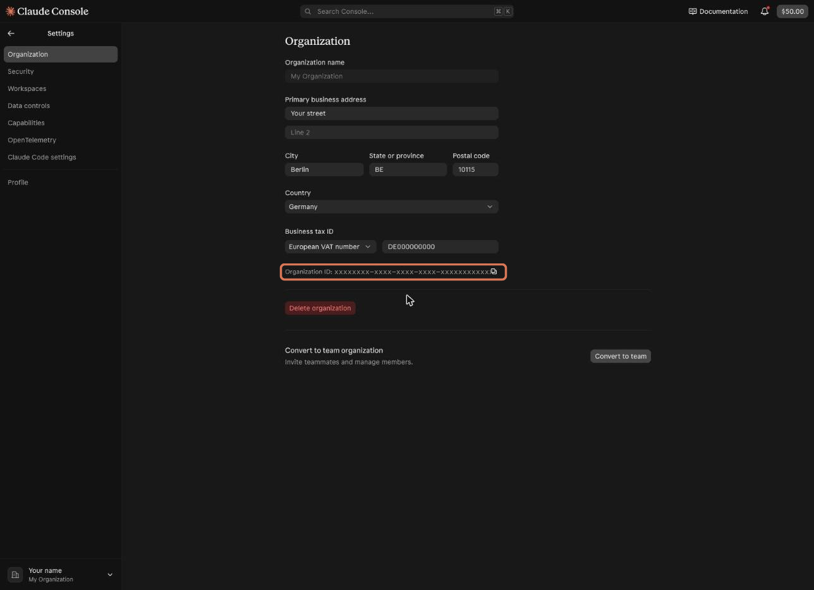
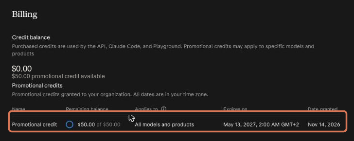
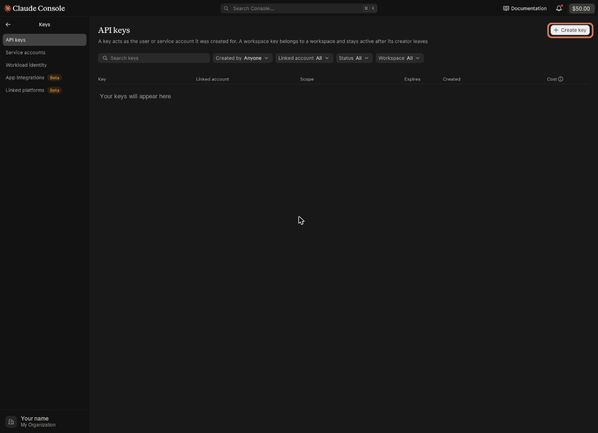
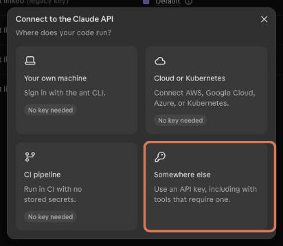
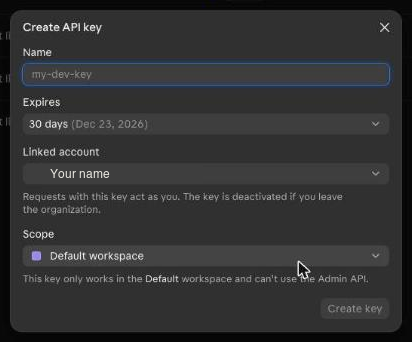

# Your $50 Claude API credits: how to get them and use them

**Claude Community Berlin · Claude Workshop x The Delta · Friday 4 December 2026**

Every confirmed attendee gets **$50 in Anthropic API credits** to build with during the workshop. It takes about five minutes. **Do steps 1 and 2 before you arrive**, so nobody gets stuck on the Wi-Fi when we start.

---

## ⚠️ Use the same email everywhere

Sign in to the Claude Console with **the same email address you used to register on Luma**.

Credits are matched to the email on your Luma registration. If you register with one email and sign in with another, the credits won't find you.

---

## 1. Sign in to the Claude Console

Go to **[platform.claude.com](https://platform.claude.com)** (console.anthropic.com takes you to the same place) and sign in, or create an account, **with your Luma email**.

> The Console is not the same as the claude.ai chat app. It's where API credits and API keys live. You can use the same email for both.

## 2. Check your Organization (this is the step that matters)

Credits are added to an **Organization**, not to you as a person.

Open **Settings → Organization**. When you create a Console account you get an organization automatically. Your **Organization ID** is at the bottom of the page, with a copy button next to it.



> ❗ If you redeem the credits without an organization selected, the code silently won't apply. The error won't tell you why.

## 3. Redeem your credits

You'll get your redemption link from us around the workshop. The link only opens **on the day of the event**.

Open the link and redeem it **into your Organization** from step 2.

## 4. Check your balance

Go to **Settings → Billing**. Under **Promotional credits** you should see **$50.00 of $50.00**.



If you don't see it, jump to [Troubleshooting](#troubleshooting).

## 5. Create an API key (only if you want to use the credits outside the Console)

You don't need a key to try things in the Console's Workbench. You do need one for Claude Code or your own code.

Go to **Settings → API keys** and click **Create key**, top right.



The Console asks where your code runs. Choose **Somewhere else** to get a classic API key.



Fill in the form:



- **Name**: anything, for example `berlin-workshop`.
- **Expires**: **30 days** is a good choice. A key that expires by itself is one less thing to clean up.
- **Linked account**: you.
- **Scope**: the default workspace is fine.

Click **Create key** and copy the key straight away. **It's only shown once.**

---

## 6. Use the credits

### No code: the Workbench

In the Console, open **Workbench** (also called Playground) and start prompting. Everything you run there is paid from your credits.

### With Claude Code: the easy way (recommended)

Let Claude set it up for you. Your key never goes into the chat. You paste it into a file yourself.

1. Create a folder for your project and start Claude Code in it.
2. Copy this prompt and paste it into Claude Code:

```text
I got Anthropic API credits at a workshop. I want Claude Code in this folder
to use my API key instead of my Claude subscription. Please set it up safely:

1. Create a file called .env in this folder with one line:
   ANTHROPIC_API_KEY=
   Leave the value empty. I will paste my key in myself.
2. Make sure .env is listed in .gitignore (create .gitignore if it doesn't
   exist), so my key is never committed.
3. Create or update .claude/settings.local.json in this folder with an
   "apiKeyHelper" that reads the key from that .env file, using the full
   path to the file. Keep any settings that are already there.
4. Never open, print or ask me for my key, and don't read .env after I
   fill it in.
5. When you're done, give me short, simple steps: open .env, paste my key
   right after the = sign, save, quit Claude Code, start it again in this
   folder, and run /status to check that it now says the API key is in use.
```

3. Open the new `.env` file, paste your key right after `ANTHROPIC_API_KEY=` (no spaces, no quotes) and save.
4. Quit Claude Code (`/exit`) and start it again **in the same folder**. If it asks whether to use the API key, say yes.
5. Run `/status`. You should see the API key in use, not your Claude Pro or Max login.

This only applies to that folder. Everywhere else, Claude Code keeps using your normal subscription.

> On Windows, this works in WSL or Git Bash. If you're on plain Windows and it doesn't work, use the manual way below or find one of the hosts.

### With Claude Code: the manual way

By default Claude Code uses your Claude Pro or Max subscription, and the credits just sit there. To spend the credits instead, set the key in the terminal where you run Claude Code:

```bash
export ANTHROPIC_API_KEY=sk-ant-...   # the key from step 5
claude
```

Inside Claude Code, run `/status`. If you see `API key: ANTHROPIC_API_KEY`, you're spending the credits. If you still see your Claude Pro or Max login, the variable didn't reach that terminal. Set it again and restart Claude Code.

To go back to your subscription:

```bash
unset ANTHROPIC_API_KEY
```

> Set the key in the terminal you're working in, not in `~/.zshrc`. You'll probably want your subscription back tomorrow.

---

## Troubleshooting

| What you see | Why | Fix |
|---|---|---|
| No credits arrived, or the code is rejected | You signed in with a different email than your Luma registration | Sign in with the email you used on Luma |
| "Code not valid", or nothing happens when you redeem | Redeemed without an organization selected | Select your organization (step 2) and try again |
| Redeemed fine, but the balance is still $0 | Redeemed into a different organization than the one you're looking at | Check the organization switcher, bottom left in the Console |
| The link doesn't open yet | Redemption links open on the day of the event | Try again on 4 December |
| `/status` still shows your Claude Pro or Max login | The key isn't reaching Claude Code | Easy way: check the key is saved in `.env` right after the `=`, then restart Claude Code in that folder. Manual way: run `echo $ANTHROPIC_API_KEY`; if it's empty, set it again and restart Claude Code |

---

## Two rules

- **Never share your API key.** Not in a chat group, a screenshot, a gist or a repo. If it leaks, delete the key in the Console right away and create a new one.
- **The credits are yours to keep.** Whatever you don't spend at the workshop stays in your organization until it expires. Go build something.

---

Questions on the night? Find Amin or one of the hosts.
